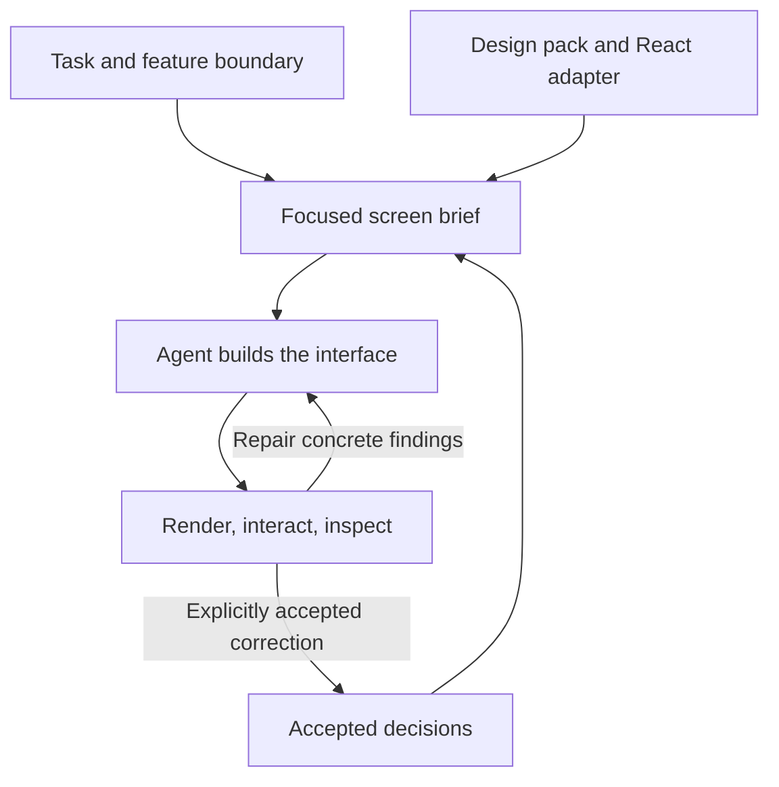

# Functional Minimalism architecture

Design judgment belongs before generation. The harness should help a coding agent decide what belongs on a screen, then carry those decisions through implementation and review.

## Why this foundation

A library knows how a dialog or button behaves. It cannot decide whether a person needs a dialog, whether a feature belongs in the task, or whether the screen feels coherent. Those decisions need a task, product constraints and an approved visual direction.

The target is less effort to understand and act. Explanatory prose should not compensate for unclear structure. Useful object names, values, units, labels, consequences and recovery remain part of the interface. “As little design as possible” is Dieter Rams's principle; applying it here is our interpretation, not an endorsement or certification. [Vitsœ](https://www.vitsoe.com/gb/about/good-design) documents the principles. [W3C](https://www.w3.org/WAI/WCAG22/Understanding/labels-or-instructions.html) explains why understandable input labels and instructions matter.

## The working loop



| Layer | Responsibility | Current implementation |
| --- | --- | --- |
| Intent | Task, object, action, essential information, required states | Screen contract; state-specific information now supported |
| Scope and composition | Features to keep, defer or omit; why a control may be icon-only | Optional validated `surface` plan; appliance planning example |
| System | Actual tokens, component sources, variants, brand references | Pinned local design pack, source checks and explicit pack revision acceptance |
| React context | Detect the declared stack, select one UI system, retain its implementation conventions | 13 registry adapters; inventory, connection and brief commands |
| Brief compiler | Select only relevant components, task decisions, stack guidance and accepted memory | Full/compact briefs; no model call or new dependency |
| Review | Find concrete functional regressions and record evidence | Source checks, browser snapshots, state/viewport audit; visual and usability review remain separate |
| Memory | Preserve only accepted corrections in the relevant scope | Global, pack, project and screen scopes; explicit supersession |

## Prompt-lab demonstration

The landing page is a demonstration layer, not part of the harness runtime.

- **Recorded mode** reads `demo/runs/index.json`, four run JSON files and their rendered screenshots. Each run stores the model, prompt, first-draft HTML, harness-pass HTML and rendered screenshots. The page shows four equal cards, each with a Before and After view.
- **First draft** is a single provider call with a neutral output contract and the invoice fixture. It receives no brief, design pack or Functional Minimalism rules.
- **Harness pass** is a second call with the same model. It receives the Atelier compact brief from `composeBrief`, invoice task guidance, the explicit Atelier visual system, the approved component gallery and a content-only outline of the first draft. CSS is deliberately omitted so the pass rebuilds composition instead of copying the draft.
- **Approved gallery** is `gallery/templates.json`: manually reviewed HTML/CSS components with approval, provenance and MIT license. The live pass includes it; the hosted `/gallery/` page renders it. A downloaded proposal must be reviewed before it is merged.
- **Live mode** uses the host free connector when configured, otherwise a visitor key. Four models generate four designs; each card renders its own before and after in a sandboxed iframe.
- **Rendered measures** are used by the offline benchmark, not shown on the demo page: visible words, paragraph words, controls, unnamed controls, clipped controls, action-labelled controls, headings, horizontal overflow, required facts, type/colour/radius counts, coverage, contrast, filled actions and visibility. The craft score is a separate transparent heuristic in `src/craft.mjs`.
- **Benchmark** is `npm run benchmark:lab`: it measures the archived v0 runs and the current v1 runs, writes `docs/BENCHMARK.md` and `docs/benchmark.json`, and compares before/after deltas. It is not a beauty model or a human study.

The lab does not run a coding agent, a repair loop or a controlled experiment. Recorded runs are single samples; see [the experiment](EXPERIMENT.md) for a real paired study.

## React integration

Run from the downloaded harness source:

```sh
node bin/functional-minimalism.mjs react-adapters
node bin/functional-minimalism.mjs inspect-react --project ../my-react-app
# Initialize using that application's own component pack first:
node bin/functional-minimalism.mjs init ../my-react-app --pack ./existing-pack.json
node bin/functional-minimalism.mjs connect-react --project ../my-react-app --ui shadcn
node bin/functional-minimalism.mjs brief ./screen.json --compact --project ../my-react-app
```

Use the UI adapter actually detected in the app; shadcn is just the example above. Run in the application package of a monorepo. An already initialized project skips init. Regenerate START_HERE.md deliberately if using that snapshot; brief does not silently overwrite it.

| Role | Registry adapters | Behavior |
| --- | --- | --- |
| Headless/local components | shadcn/ui, Radix Primitives, Base UI, React Aria Components, Headless UI | Keep local styling and interaction semantics; inspect local exports and installed APIs |
| Styled systems | Material UI, Chakra UI, Mantine, Ant Design | Keep the existing provider, theme, density and component overrides |
| Supporting tools | Tailwind CSS, Motion / Framer Motion, Lucide React, React Hook Form | Include relevant installed-stack guidance without treating these as rival UI systems |

These are context adapters, not bundled copies of the libraries or an API normalization layer. The harness never installs all libraries together. The registry is extensible; unsupported systems can keep a custom local pack and use the ordinary workflow.

inspect-react reads package.json and optional components.json. It does not run dependency code or install anything. shadcn is detected from the local UI alias because its copied components are not reliably identified by an npm dependency. Declared primitive packages are recorded; the actual component imports remain authoritative.

connect-react creates .design-harness/react.json. It refuses overwrites and ambiguous UI systems. To change an existing connection, review the difference, move the old file aside and reconnect explicitly. Dependency/config changes fail brief/check until reviewed; irrelevant manifest formatting and scripts do not create drift. Unknown or unavailable adapters cannot silently become a new stack.

Version ranges are declarations, not resolved installed-version evidence. The context tells the coding agent to read installed types/source, run the consuming app's typecheck, and render actual components. A full build/browser compatibility matrix for all library versions has **not** been run. No automatic Figma import, code rewrite, component installation or React AST validation is implied.

## A screen is a contract, not a text quota

surface.features assigns each proposed feature a primary, secondary or omit placement and a task reason. surface.controls declares stable control IDs, names, states and text/icon presentation. Icon-only choices require a familiarity rationale; consequential controls require text. This is a design decision to verify, not proof that an icon is understood.

Annotate runtime feature containers with data-feature="timer" and controls with data-control="start". The existing demo's data-action is accepted as a control-ID fallback. The collector records visible annotations. The audit flags omitted/unplanned annotated features, missing primary features, required controls and missing feature evidence. It cannot infer features the implementation did not annotate or certify whether a visible label is understood.

essentialByState preserves information after leaving the ready state. The invoice fixture now requires supplier, amount, destination and consequence during confirmation. A clean-looking modal that loses the amount fails the audit.

For React portals, pass the active dialog's DOM root to collectSnapshot for that state. Do not assume a portaled dialog is a descendant of the page container. Annotated component identity is a declaration, not proof that the original library component rendered. Real keyboard/focus interaction checks are still required.

## Aesthetic review and progressive refinement

Use approved references and the project's actual type scale, spacing, colors and image family. Compare object prominence, alignment, scale contrast, rhythm, density and behavior across required widths. Prefer direct manipulation when it is discoverable and has keyboard/touch alternatives. A reduction pass must remove competing structure before shrinking typography or hiding information.

Each repair identifies a concrete defect and the affected state. Rerender those states after the fix. Stop after the workflow's three repair passes and report unresolved findings. Keep a deterministic failure separate from an agent's visual opinion and a human's observed task difficulty. Do not average a missing payment destination into a favorable “design score.”

## Evidence needed next

1. Compile and browser-test actual consuming React applications for each claimed version range, including portals, forms and server rendering.
2. Add type/AST checks for component identity and supported props without executing arbitrary project setup scripts.
3. Evaluate the same tasks with ordinary generation, pack-only context and full harness context. Include context tokens and failed runs in costs.
4. Observe representative people using the result, including keyboard, enlarged text and assistive technology. Measure task success, wrong actions, hesitation and corrections.

The current unit/CLI tests cover registry selection, scope, drift, refusal cases and surface checks. Existing workshop browser evidence belongs to the revision recorded in VERIFICATION.md. Token/time savings and universal visual quality remain unproven.
